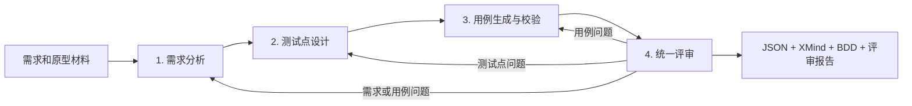

# TestSpec SOP

TestSpec SOP 是一套由 Agent 按需求设计和评审测试用例的流程：先分析需求，再提炼测试点、生成完整用例，最后统一评审。标准交付包含 **JSON、XMind、伴生 BDD 特性文件和评审报告**。

流程以已确认的需求和项目交互规范为依据。Skill 负责分析、设计和评审；仓库中的脚本负责确定性校验、导出和辅助检查，不能单独完成业务需求分析或代替语义评审。

## 快速开始

在本项目目录中，向能够读取项目 Skill 的 Agent 提供 PRD、蓝湖链接、可交互 HTML 或需求片段，并说明本次范围和变更名称。例如：

> 根据提供的需求，按 TestSpec SOP 完成需求分析、测试点、完整用例和统一评审，变更名为 `example`。遇到会影响通过或失败判断的未确认规则，先记录澄清项。

如果 Agent 环境已识别这些 Skill，可按顺序使用 `$prd-analysis`、`$test-points`、`$testcase-generate`、`$testcase-reviewer`；否则让 Agent 读取仓库中对应的 `SKILL.md` 并按其规则执行。

开始分析、提炼测试点和生成用例前，先读取根目录或当前变更目录适用的 `project-interaction-spec.md`。当前根目录的[项目交互规范](project-interaction-spec.md)适用于 Jellycat：文本长度默认 20 字符、模块数量默认 8 项；PRD 明确指定长度或数量时按 PRD 执行。键盘输入、粘贴截断及达到数量上限后的交互以规范原文为准。开始新项目时先确认该规范是否适用；规范与需求存在未确认冲突时先澄清。

## 流程与产物



| 阶段 | Skill | 做什么 | 主要产物 |
|---|---|---|---|
| 1 | [prd-analysis](skills/prd-analysis/SKILL.md) | 整理需求事实、范围、风险和待澄清问题 | `requirements.md`、`requirements-analysis.md` |
| 2 | [test-points](skills/test-points/SKILL.md) | 将已确认需求提炼为“要验证什么” | `specs/testpoints.md` |
| 3 | [testcase-generate](skills/testcase-generate/SKILL.md) | 按测试点生成完整用例、XMind 和核心 BDD 场景 | `artifacts/testcases.json`、`<name>_cases.xmind`、`<name>_features.feature` |
| 4 | [testcase-reviewer](skills/testcase-reviewer/SKILL.md) | 统一执行通用用例评审、BDD 场景评审和 SOP 检查 | `review-report.md` |

每次需求变更使用一个工作目录。`requirements.md` 是优先读取的规范需求源；不存在时读取 `proposal.md`。两者都不存在时，由 `prd-analysis` 根据用户提供的材料建立最小需求源。

```text
testspec/changes/<change-name>/
├── requirements.md                  # 规范需求源；缺省时使用 proposal.md
├── requirements-analysis.md        # 需求分析、风险和澄清项
├── specs/
│   └── testpoints.md                # 测试点
├── artifacts/
│   ├── testcases.json               # schema v2 完整用例集
│   ├── <name>_cases.xmind           # 完整用例集，XMind 8 格式
│   └── <name>_features.feature      # 伴生 BDD 核心场景
└── review-report.md                 # 通用反馈、BDD 评审、SOP 检查和 Gate
```

默认按四个阶段执行。只有用户明确要求跳过需求分析时，测试点阶段才从规范需求源降级提炼，并标记低置信度。项目的 `.gitignore` 默认忽略 `testspec/`、`artifacts/` 和 `.testspec-cache/`；需要保存或同步产物时按团队约定处理。

## 1. 需求分析：prd-analysis

读取用户提供的需求材料，建立或更新可追溯的需求源，分析功能范围、业务规则、角色权限、状态、边界、异常及测试风险，输出 `requirements-analysis.md`。

- **蓝湖 / Axure**：优先使用 [direct_extract_axure.py](skills/prd-analysis/scripts/direct_extract_axure.py) 获取页面文字和图片资源，再按清单逐页核对文字、逐张视觉阅读图片。下载成功不等于内容已读完；页面、图片或交互状态不可访问时记录缺口。详见[蓝湖输入说明](skills/prd-analysis/references/lanhu-prd-input.md)。
- **可交互 HTML**：建立按钮清单，逐项执行可访问的交互并记录现象；原型观察结果和已确认需求分别记录，不把原型现象直接当成生产系统的预期。
- **信息不足**：区分已确认事实、分析推断和待澄清事项。会改变测试通过或失败判断的规则未确认时，先澄清，不编造正式预期。

PRD 和用户确认内容是需求事实来源。历史用例可用于参考覆盖或表达，不能覆盖当前需求，也不能为未确认规则提供 Oracle。

## 2. 测试点设计：test-points

读取规范需求源和需求分析结果，按模块、功能和适用分类提炼测试点。每个测试点写清验证目标、`TP_ID`、优先级、关联需求、Oracle 状态与范围，以及采用的测试设计方法；不写具体操作步骤和测试数据。

可按目标选择以下 12 种正式方法，不要求每个测试点都使用全部方法，也不用方法数量判断覆盖是否充分：

等价类、边界值、判定表、流程分析、状态迁移、错误推断、正交实验、因果图、配对组合、基于属性的测试、变形测试、语法规则分析。方法选择与完成判断见[测试点方法论](skills/test-points/references/test-design-methods.md)。

新产物使用正式方法名；校验历史常见别名时会按同一规则归一，例如“等价类划分”与“等价类”可对应。未知方法须澄清；归一比较不会改写原文件。

已确认且在范围内的需求应能追溯到测试点；未确认且影响 Oracle 的事项以 `Q-001` 等编号记录为待澄清，确认后再转为正式测试点。功能、边界、异常、权限和跨功能交互均以可观察业务结果为准。埋点和兼容性矩阵仅在需求给出明确口径与可判定结果时纳入；需求列出的必测环境组合须全部保留，仅在抽样许可、覆盖目标及约束明确时使用配对或正交抽样。

## 3. 用例生成：testcase-generate

根据测试点和已确认需求展开完整用例集。每条用例至少引用一个有效的当前 `TP_ID`，步骤和预期覆盖该测试点的验证目标；来源、信任状态和需求版本继续向下传递。

### JSON 字段与描述

`artifacts/testcases.json` 使用 `schema_version: 2`，每条用例包含以下八项业务字段：

| 字段 | 内容 |
|---|---|
| `module`、`submodule` | 模块、功能点 |
| `test_name` | `{模块}_{功能点}_{场景}`；场景简短、直白，保留区分条件 |
| `preconditions` | 与本例相关的必要角色、权限和初始状态；无必要条件可为空 |
| `test_data` | 本例实际使用或比对的值、单位、格式及边界；无必要数据可为空 |
| `steps` | 按顺序编号，写清动作和对象 |
| `expected_result` | 按序号写清可观察对象、状态或变化及判定依据 |
| `priority` | `p0`、`p1` 或 `p2` |

字段键必须存在；`preconditions` 和 `test_data` 允许为空字符串。`id`、`tp_refs`、`type`、`origin`、`trust` 等用于追溯和评审，不替代八项业务字段。

测试名称、前置条件、测试数据、操作步骤和预期结果参考品牌方 UAT 用例的直白表达，只保留执行和判定所需的信息；保留关键条件、准确数据、边界和中间检查。写法详见[用例设计规则](skills/testcase-generate/references/case-design-rules.md)。

### XMind 与 BDD

- **XMind**：默认使用 XMind 8 格式。层级为“模块 → 子模块 → 场景名称”；前置条件、测试数据、操作步骤为同级子节点，预期结果位于操作步骤下。`p0` 无标记，`p1` 和 `p2` 使用对应优先级标记。JSON 保留完整三段式名称，脑图场景名称去掉匹配的父级前缀。
- **BDD**：从同一需求和完整用例集中提取核心业务主路径及有依据的关键异常，保存为 `artifacts/<name>_features.feature`。使用业务语言描述 Given / When / Then，结果须可观察；BDD 是核心场景的伴生产物，不替代完整用例集。

始终交付当前范围的完整集。冒烟仅作为完整集内的 `type`、`regression_tier` 和优先级分类，不另生成冒烟 JSON 或 XMind。Excel 不属于默认产物或验收门禁。

## 4. 统一评审：testcase-reviewer

评审输入包括规范需求源、完整 JSON、测试点和全部伴生 BDD。`testcase-reviewer` 是唯一入口，原 `testcase-review` 是内部模块。

同一模型先分别按通用用例和 BDD 规则评审，再执行 SOP 检查并统一汇总；这里的 BDD 独立场景评审指单独检查 BDD 质量，不代表由不同模型或独立评审者完成。

报告应包含：

- 完整“通用评审反馈”：逐项保留 `GR-001` 等编号、原等级、定位、依据、问题、影响和建议，并记录每项处置；没有发现也写明检查范围和结论。
- 单列“BDD 场景评审”：记录评审状态、全部评审文件、检查内容和结论；BDD 发现关联相同 GR 编号，不重复计数。
- R1–R6、H1–H8 共 14 项检查结果、问题清单、四项描述检查和 `review_gate`。
- 本次评审的 JSON、测试点和全部 BDD 文件的 SHA-256；BDD 文件路径与摘要记录在 `reviewed_artifacts.bdd_features_sha256`。

| 规则检查 | 启发式检查 |
|---|---|
| R1 测试点覆盖度；R2 命名契约；R3 优先级分布 | H1 冗余；H2 预期结果质量；H3 意图一致性；H4 前置条件 |
| R4 字段完整性；R5 可执行性；R6 需求与测试点追溯 | H5 风险与边界；H6 可维护性；H7 回归价值；H8 测试亮点 |

完整规则见[评审维度细则](skills/testcase-reviewer/testcase-review/references/review-dimensions.md)。严格模式按 `tp_refs` 计算测试点覆盖率，**95% 是 R1 通过线和生成校验条件**；比例达标不能代替对已确认需求、关键路径和必要边界的逐项检查。

### 交付通过条件

完整输入和评审均已完成，所有通用及 BDD 发现已逐项处置，同时满足原有 Review Gate：

1. `s1_unresolved_count = 0`，且 `s1_issue_ids = []`。
2. `description_unresolved_count = 0`，且 `description_issue_ids = []`。
3. `review_gate.status = pass`。

四项描述指前置条件、测试数据、操作步骤和预期结果。已确认但未解决的描述问题即使为 S2/S3 或标记为 `accepted`，仍阻断描述门禁；复审确认 `resolved` 后才能移出。来源不明或不可信的导入用例按评审流程处理，不能仅因格式合格而放行。

BDD 缺失、为空、未评审或评审记录不完整时，整轮评审不能标为完成；输入健康检查未完成时不补造通过的 Gate。旧报告若缺少 BDD 评审记录、指纹或四项描述门禁字段，需要重新评审。

## 版本、返修与重评

- 各阶段读取规范需求源和直接上游产物，按[上下文协议](skills/_testspec-shared/references/context-protocol.md)传播 `source_revision`、阻塞问题和待更新产物；下游阶段不自行递增版本。上游版本过旧时回到相应阶段重新生成；无版本的历史材料按 Legacy 规则处理，不补造版本。
- 需求或验收规则不清楚，返回 `prd-analysis`；测试点缺失或粒度不合适，返回 `test-points`；用例字段、步骤或预期有问题，返回 `testcase-generate`。返修后重新执行必要校验和统一评审。
- 完整 JSON、测试点或 BDD 内容变化后须重新评审；BDD 文件新增、删除或改名同样需要重新评审当前全部 BDD，再更新指纹。只重算摘要不代表已完成评审。

## 本地校验与导出

以下命令在项目根目录执行。先把示例变更名改为实际名称：

```bash
CHANGE_NAME="your-change"
CHANGE_DIR="testspec/changes/$CHANGE_NAME"
```

### 校验完整用例并导出 XMind

```bash
# 全量校验 JSON 与测试点；--full 不创建缓存或明细文件
python3 -B skills/_testspec-shared/scripts/validate_testcases.py \
  --input "$CHANGE_DIR/artifacts/testcases.json" \
  --testpoints "$CHANGE_DIR/specs/testpoints.md" \
  --full --pretty

# 从 JSON 导出 XMind 8；同名输出文件会被覆盖
python3 -B skills/testcase-generate/scripts/generate_xmind.py \
  --input "$CHANGE_DIR/artifacts/testcases.json" \
  --output "$CHANGE_DIR/artifacts/${CHANGE_NAME}_cases.xmind" \
  --title "测试用例"

# 比较 JSON 与 XMind 的字段、层级、顺序和优先级标记
python3 -B skills/_testspec-shared/scripts/verify_eval_artifacts.py xmind \
  --json "$CHANGE_DIR/artifacts/testcases.json" \
  --xmind "$CHANGE_DIR/artifacts/${CHANGE_NAME}_cases.xmind"
```

用例校验的 `PASS` 表示确定性检查通过；`WARN` 和 `FAIL` 的命令退出码均为非零，需逐项查看。相似用例 `review_candidates` 交由 Review 比较，不能按相似度自动删除。默认不加 `--full` 时，脚本会在变更目录的 `.testspec-cache/validation/` 保存内部缓存或明细；缓存不是交付物。

### 检查上下文、BDD 与评审报告

```bash
# 生成阶段完成后：核对版本、上下文及 BDD 文件存在、可读取且非空
python3 -B skills/_testspec-shared/scripts/validate_context_chain.py \
  --change-dir "$CHANGE_DIR" --through generate

# 评审报告写入后：核对完整链路、BDD 评审记录与 BDD 指纹
python3 -B skills/_testspec-shared/scripts/validate_context_chain.py \
  --change-dir "$CHANGE_DIR" --through review

# 检查 14 项矩阵，以及通用反馈与处置的报告结构
python3 -B skills/_testspec-shared/scripts/verify_eval_artifacts.py review \
  --report "$CHANGE_DIR/review-report.md"
python3 -B skills/_testspec-shared/scripts/verify_eval_artifacts.py feedback \
  --report "$CHANGE_DIR/review-report.md"
```

上下文校验可选传入 `--expected-version <版本号>`。这些脚本检查文件、结构、版本、记录和指定指纹；不证明 Gherkin 语法或业务语义正确，也不代表实际执行了产品测试。完整输入和 BDD 评审已完成时，Gate 为 `blocked` 的报告仍可能通过结构校验；最终以实际评审结论和 Gate 状态为准。

### 可选：准备通用评审投影

需要单独准备中立材料时，可将用例和需求投影到标准输出；该脚本不会修改输入，也不会执行评审：

```bash
python3 -B skills/testcase-reviewer/testcase-review/scripts/prepare_reviewer_input.py \
  --testcases "$CHANGE_DIR/artifacts/testcases.json" \
  --requirements "$CHANGE_DIR/requirements.md"
```

以 `proposal.md` 为规范需求源时，将 `--requirements` 改为相应路径。投影不包含完整上下文、测试点和 BDD，不能替代标准 SOP 的评审输入。

## 维护与检查

修改 Skill、契约或脚本后，可运行以下检查；以本次实际结果为准，测试通过不等于模型前向评测、真实 PRD 执行或产品测试已完成。

```bash
python3 -B -m unittest discover -s skills/prd-analysis/tests -p 'test_*.py'
python3 -B -m unittest discover -s skills/testcase-generate/tests -p 'test_*.py'
python3 -B -m unittest discover -s skills/_testspec-shared/tests -p 'test_*.py'
python3 -B -m unittest discover -s skills/testcase-reviewer/testcase-review/tests -p 'test_*.py'

python3 -B skills/_testspec-shared/scripts/validate_skill_contracts.py
python3 -B skills/_testspec-shared/scripts/validate_evals.py
python3 -B skills/testcase-reviewer/scripts/validate_skill_repo.py skills/testcase-reviewer
```

`validate_evals.py` 检查合成评测的定义和结构，不自动运行模型评测。

## 目录与规范索引

```text
TestSpec_SOP/
├── AGENTS.md                         # 项目执行规则
├── project-interaction-spec.md       # 当前项目交互与 Oracle 规范
├── README.md
└── skills/
    ├── prd-analysis/                 # 需求分析
    ├── test-points/                  # 测试点设计
    ├── testcase-generate/            # 用例生成及 XMind 导出
    ├── testcase-reviewer/            # 统一评审入口及内部 SOP 模块
    └── _testspec-shared/             # 共享协议、模板、校验脚本与测试
```

- [输出契约](skills/_testspec-shared/references/output-contracts.md)：产物、字段、XMind 和 Review Gate。
- [上下文传播协议](skills/_testspec-shared/references/context-protocol.md)：版本、stale、BDD 指纹和重评。
- [命名契约](skills/_testspec-shared/references/naming-contract.md)：模块、功能点和用例名称。
- [用例设计方法](skills/testcase-generate/references/test-design-methods.md)：12 种方法的展开与完成判断。
- [统一评审与发现处置](skills/testcase-reviewer/testcase-review/references/independent-reviewer.md)：原始通用反馈、GR 处置与 SOP 检查。
- [统一评审报告模板](skills/_testspec-shared/templates/review-report-template.md)：完整报告字段和上下文。
