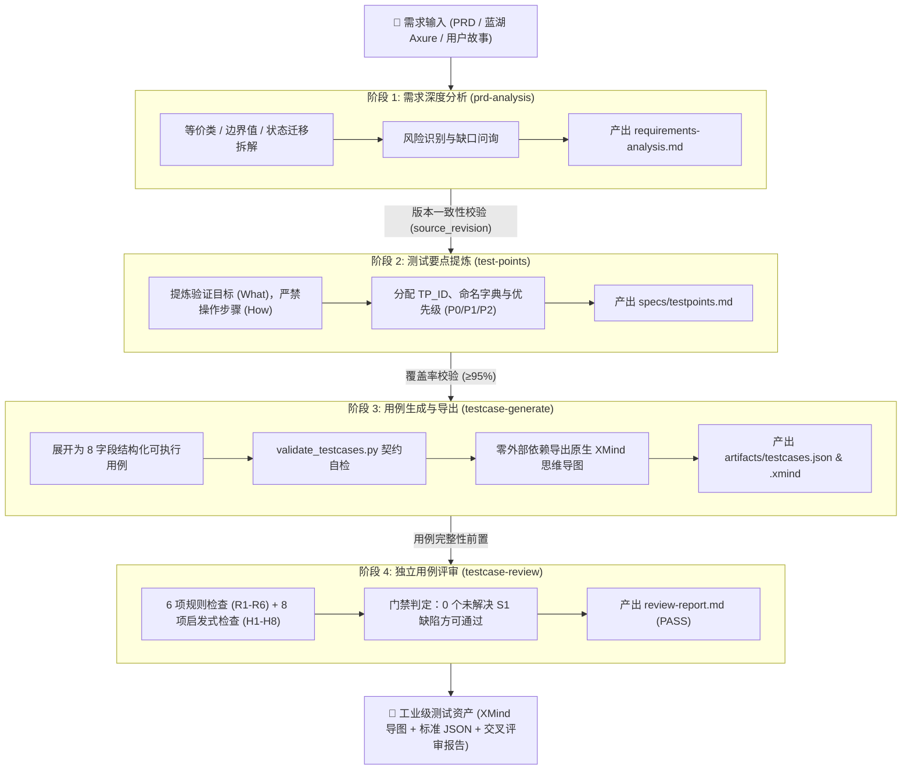

# TestSpec SOP 🚀

[](https://opensource.org/licenses/MIT)
[](https://www.python.org/)
[]()
[]()
[]()

> **面向 AI Coding Agent 的工程化测试用例标准操作流程（SOP）与 Skills 套件**
> *Industrial-grade Functional Test Specification Pipeline & Agent Skills for SDETs*

---

## 📖 项目简介 (Overview)

**TestSpec SOP** 是一套专为测试开发工程师（SDET）、质量保障工程师（QA）及技术团队打造的 **AI 规范化测试流水线**。

通过严谨的**四阶段递进式工程流水线**，将“需求深度分析 → 测试要点提炼 → 8 字段结构化用例展开与 XMind 导出 → 14 维度独立交叉评审”全流程严格解耦与标准化，杜绝 AI 一步跳步生成带来的幻觉遗漏、步骤泛化与断言缺失问题，确保输出工业级交付标准的测试资产。

> 📌 **测试边界**：输出功能测试用例，并允许有明确需求口径的埋点与兼容性矩阵用例；接口协议/安全/性能等非功能用例不进入本流程正式输出。

---

## 🔄 核心流水线架构 (Core Pipeline)



### 阶段职责与质量门禁对照

| 阶段 / Skill | 核心职责 (验证什么) | 主要输入 | 主要输出产物 | 出口质量门禁 |
|---|---|---|---|---|
| **1. `prd-analysis`** | 深度拆解需求边界、等价类、状态迁移与潜在风险 | PRD 文档 / 蓝湖原型链接 | `requirements.md`<br/>`requirements-analysis.md` | 需求事实可追溯，明确风险与待确认清单 |
| **2. `test-points`** | 提炼纯粹验证目标（What），拒绝混入步骤（How） | `requirements-analysis.md` | `specs/testpoints.md` | 独立 `TP_ID`、命名字典、Oracle 状态及优先级清晰 |
| **3. `testcase-generate`** | 扩展为 8 字段可执行用例，导出原生 XMind 导图 | `specs/testpoints.md` | `artifacts/testcases.json`<br/>`artifacts/testcases.xmind` | 8 字段完整；TP 覆盖率 ≥95%；JSON/XMind 契约自检通过 |
| **4. `testcase-review`** | 独立第三方交叉评审，执行 14 维度深度检查 | `testcases.json`<br/>`specs/testpoints.md` | `review-report.md` | 14 维度检查完成；**0 个未解决 S1 阻塞缺陷** |

---

## ⚡ 快速上手 (Quick Start)

### 方式一：作为 Agent Skills 流水线运行（推荐）

TestSpec 原生适配 Claude Code、Codex、Google Antigravity、Cursor、Windsurf 等支持 Agent Skills 的 AI 编码工具：

```text
# 步骤 1：深度分析需求（支持粘贴文档或蓝湖 Axure 链接）
使用 $prd-analysis 读取并分析需求：<需求内容或蓝湖链接>

# 步骤 2：提炼纯验证要点
使用 $test-points，从 requirements-analysis.md 提炼测试点清单（仅验证目标，不写步骤）

# 步骤 3：生成 8 字段测试用例并导出 XMind
使用 $testcase-generate，展开为标准用例并通过内置脚本导出 XMind

# 步骤 4：执行 14 维度交叉评审
使用 $testcase-review，针对生成的用例执行独立评审并输出 review-report.md
```

> **↩️ 智能回退机制**：
> - 需求存疑：回退至 `prd-analysis` 补充确认；
> - 测试点遗漏或粒度不当：回退至 `test-points` 调整；
> - 用例步骤模糊或预期不具体：回退至 `testcase-generate` 定向修复；
> - Review 发现 S1 阻塞缺陷：必须修复通过后方可交付，严禁带病放行。

---

### 完整集通过后选取 Smoke 执行集

先生成完整用例集，通过现有校验（对全部 TP 覆盖率 ≥95%）与 Review Gate，再按 `regression_tier=Smoke` 选取 p0 核心闭环。Review 报告记录已评审完整 JSON 和测试点的 SHA-256；文件变化后先重新 Review。

```bash
python3 -B skills/testcase-generate/scripts/select_smoke.py \
  --change-dir testspec/changes/<name>
```

输出 `artifacts/smoke-testcases.json`，保留原用例 ID、八字段、TP 追溯和顺序。完整 JSON 与 XMind 继续保留；需要冒烟导图时，用现有 XMind 脚本将执行集导出到 `artifacts/smoke-cases.xmind`。Smoke 是评审后的执行子集，覆盖统计仍以完整集为准。

### 方式二：使用内置 CLI 工具

仓库内置开箱即用的轻量 Python 脚本（纯标准库，无重量级三方依赖）：

```bash
# 1. 解析蓝湖 Axure 原型（提取页面文本与交互说明）
python3 skills/prd-analysis/scripts/direct_extract_axure.py \
  --url "https://lanhuapp.com/web/#/item/project/detail?tid=...&pid=..." \
  --output-dir "./output/prd_extracted"

# 2. 测试用例契约与覆盖率合规自检
python3 skills/_testspec-shared/scripts/validate_testcases.py \
  --input artifacts/testcases.json \
  --testpoints specs/testpoints.md \
  --pretty

# 3. 将结构化用例一键生成 XMind 思维导图
python3 skills/testcase-generate/scripts/generate_xmind.py \
  --input artifacts/testcases.json \
  --output artifacts/testcases.xmind \
  --title "功能测试用例思维导图"
```

---

## 📐 核心规范与交付物标准

正式用例交付与验收产物为 `artifacts/testcases.json` 和 `artifacts/testcases.xmind`；Excel 不属于本流程的默认产物或验收门禁。

### 1. 严格的 8 大标准业务字段
每条用例格式严格统一，兼容 Jira、MeterSphere、TestRail 等主流管理平台：
- `module`（模块）/ `submodule`（子模块）
- `test_name`（用例名称，格式：`{模块}_{子模块}_{场景}`）
- `preconditions`（前置条件）
- `test_data`（测试数据）
- `steps`（按序号分步的可执行操作步骤）
- `expected_result`（可判定的客观预期结果 / Oracle）
- `priority`（`p0` 冒烟 / `p1` 核心 / `p2` 边界异常）

### 2. 场景名称规范（简短、直白、去套话）
- **见名知意**：用短句清楚说明“测什么”，如“正确账号密码登录成功”、“无权限时禁止导出”。
- **坚决去套话**：禁止“验证……功能是否正常”、“测试……场景”等无意义填充词。
- **XMind 纯净呈现**：思维导图叶子节点仅显示场景短句，自动剥离父级模块/子模块前缀。

### 3. 原生 XMind 导图展示层级
```text
功能测试用例集 (Root)
 └── 用户认证 (Module)
      └── 密码登录 (Submodule)
           └── 正确账号密码登录成功 (场景短句，p0 无标 / p1 打 1 号标 / p2 打 2 号标)
                ├── 前置条件：\n1. 账号处于正常激活状态...
                ├── 测试数据：\n账号: test_user, 密码: Password123!
                └── 操作步骤：\n1. 打开登录页面\n2. 输入账号密码\n3. 点击登录
                     └── 预期结果：\n1. 接口返回成功 Token\n2. 页面跳转至首页
```

### 4. 14 维度 Review 质量门禁体系
- **6 项规则检查 (R1-R6)**：R1 测试点覆盖度(≥95%)、R2 命名契约与场景质量、R3 优先级分布、R4 字段完整性、R5 可执行性、R6 双向可追溯性。
- **8 项启发式检查 (H1-H8)**：H1 冗余检测、H2 预期结果判定质量、H3 意图一致性、H4 前置条件充分性、H5 风险与边界覆盖、H6 可维护性、H7 回归价值、H8 亮点与安全合规。

---

## 🗂️ 仓库目录结构 (Repository Layout)

```text
.
├── README.md                           # 项目主说明文档
├── AGENTS.md                           # AI Agent 行为准则与 SDET 专家思维规范
└── skills/                             # 核心 Agent Skills 套件
    ├── prd-analysis/                   # [阶段 1] 需求分析技能 (Axure解析/等价类/边界值)
    │   ├── scripts/                    # 蓝湖直连提取脚本 (direct_extract_axure.py)
    │   └── tests/                      # 单元测试集
    ├── test-points/                    # [阶段 2] 测试点设计技能 (提炼What/分配TP_ID)
    │   └── references/                 # 命名字典、TP 规范与设计模板
    ├── testcase-generate/              # [阶段 3] 用例生成与导出技能 (8字段用例/XMind导出)
    │   ├── scripts/                    # 原生 XMind 生成器 (generate_xmind.py)
    │   └── tests/                      # 用例语法校验与导出测试
    ├── testcase-review/                # [阶段 4] 用例独立评审技能 (14维度门禁/报告)
    │   └── review-report-template.md   # 标准评审报告模板
    └── _testspec-shared/               # 跨技能公共底座 (契约校验/上下文协议/自检工具)
        ├── scripts/                    # 契约与用例校验脚本 (validate_testcases.py 等)
        └── tests/                      # 上下文传递与契约集成测试
```

---

## 🧪 自动化测试与质量验证 (Verification)

仓库内置了完善的自动化测试与契约自检套件，确保流水线稳定性：

```bash
# 1. 运行全部单元测试 (63 项测试全部通过)
python3 -m unittest discover -s skills/prd-analysis/tests
python3 -m unittest discover -s skills/testcase-generate/tests
python3 -m unittest discover -s skills/_testspec-shared/tests

# 2. 验证 Skills 依赖与输出契约合规性
python3 skills/_testspec-shared/scripts/validate_skill_contracts.py

# 3. 运行 Evals 评估集自检
python3 skills/_testspec-shared/scripts/validate_evals.py
```

---

## 🤝 协作原则 (Principles)

在参与项目演进或编写测试用例时，严格遵循 [AGENTS.md](AGENTS.md) 约定：
1. **先想清楚再动手**：不主观臆测需求，遇疑主动问询澄清。
2. **能简单就别复杂**：坚持最简有效方案，剔除冗余流程。
3. **只改该改的内容**：聚焦任务范围，严格保护被测系统逻辑。
4. **断言必须精准有据**：用例预期结果必须具备可验证的客观业务判定依据（Oracle）。

---

## 📄 开源许可证 (License)

本项目基于 [MIT License](https://opensource.org/licenses/MIT) 开源。
