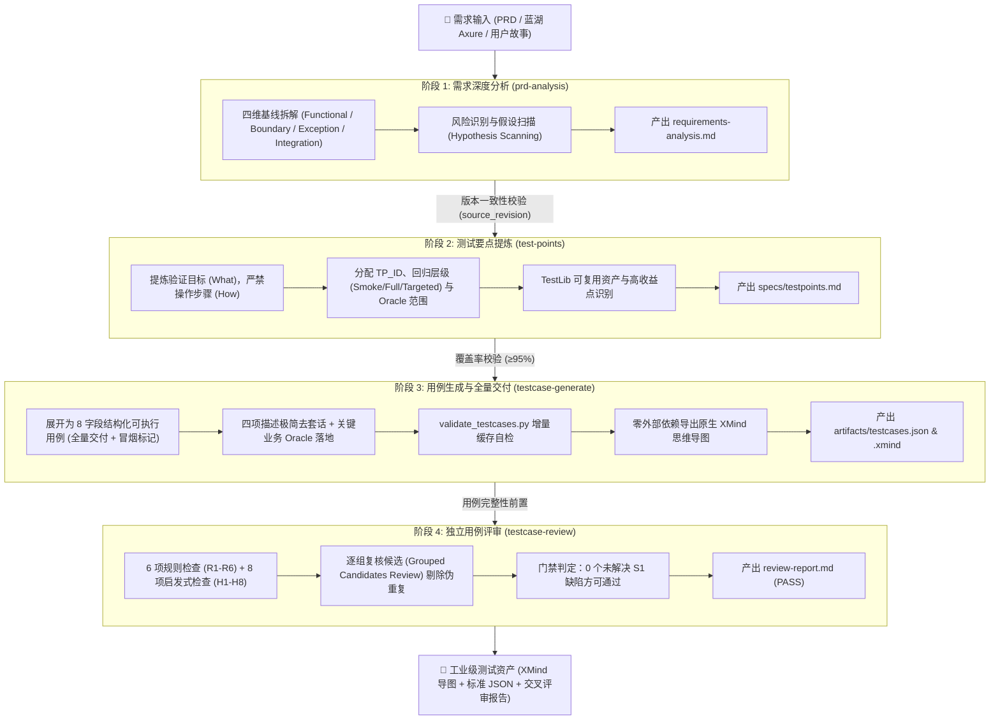

# TestSpec SOP 🚀

[](https://opensource.org/licenses/MIT)
[](https://www.python.org/)
[]()
[]()
[]()

> **面向 AI Coding Agent 的工程化测试用例标准操作流程（SOP）与 Skills 套件**
> *Industrial-grade Functional Test Specification Pipeline & Agent Skills for SDETs*

---

## 📖 项目简介 (Overview)

**TestSpec SOP** 是一套专为测试开发工程师（SDET）、质量保障工程师（QA）及技术团队打造的 **AI 规范化测试流水线**。

通过严谨的**四阶段递进式工程流水线**，将“需求深度分析 → 测试要点提炼 → 8 字段结构化用例展开与 XMind 导出 → 14 维度独立交叉评审”全流程解耦与标准化，杜绝 AI 一步跳步生成带来的幻觉遗漏、步骤泛化与断言缺失问题，确保输出工业级交付标准的测试资产。

> 📌 **测试边界**：输出功能测试用例，并允许有明确需求口径的埋点（Tracking）与兼容性矩阵（Compatibility）用例；接口协议/安全/性能等非功能用例不进入本流程正式输出。

---

## 🔄 核心流水线架构 (Core Pipeline)



### 阶段职责与质量门禁对照

| 阶段 / Skill | 核心职责 (验证什么) | 主要输入 | 主要输出产物 | 出口质量门禁 |
|---|---|---|---|---|
| **1. `prd-analysis`** | 深度拆解需求边界，从 Functional/Boundary/Exception/Integration 四维度识别风险与待确认清单 | PRD 文档 / 蓝湖原型链接 | `requirements.md`<br/>`requirements-analysis.md` | 需求事实可追溯；异常类型覆盖完整；明确假设与待确认清单 |
| **2. `test-points`** | 提炼纯粹验证目标（What），拒绝混入步骤（How）；划分回归层级与复用资产 | `requirements-analysis.md` | `specs/testpoints.md` | 独立 `TP_ID`、命名字典、Oracle 状态及回归层级明确 |
| **3. `testcase-generate`** | 扩展为 8 字段用例，全量交付并标记冒烟候选，执行四项描述去套话与 XMind 导出 | `specs/testpoints.md` | `artifacts/testcases.json`<br/>`artifacts/testcases.xmind` | 8 字段完整；四项描述直白通顺；TP 覆盖率 ≥95%；确定性自检 PASS |
| **4. `testcase-review`** | 独立第三方交叉评审，执行 14 维度深度检查与逐组候选复核 | `testcases.json`<br/>`specs/testpoints.md` | `review-report.md` | 14 维度检查完成；逐组候选已逐对核验；**0 个未解决 S1 阻塞缺陷** |

---

## ⚡ 核心设计原则与工程演进

### 1. 全量交付机制 (Full Delivery Standard)
- **统一全量输出**：无论用户目标是冒烟、上线验证还是回归测试，生成阶段始终生成并交付覆盖当前需求的**完整用例集**（Full Set）。
- **冒烟精准标定**：冒烟验证仅作为完整集内部的分类标记（`priority: p0` 或标注 smoke 层级），识别最短业务闭环，严禁通过裁剪用例范围代替冒烟策略。

### 2. 四项描述要求 (直白、通顺、极简去套话)
用例的核心价值在于快速执行与精准判定，杜绝“AI 套话八股文”：
- **前置条件**：只写执行前必须具备的角色、权限、数据状态，如“已登录且订单待支付”，不混入操作步骤或预期；
- **测试数据**：直接采用“字段：值”或明确数据组合，标明单位与边界（如 `金额: 99.99元`），避免“有效数据”、“测试账号”等泛称；
- **操作步骤**：动宾短句直奔目标（如 `1. 点击提交订单按钮`），按序号分步，不写“请确保进行如下操作以便验证”等修饰；
- **预期结果**：明确观察对象、状态变化与可判定的业务依据（Oracle），拒绝“操作成功/系统正常”等模糊判定；取消步骤与预期机械 1:1 数量绑架，聚焦关键业务结果。

### 3. 高效执行与指纹缓存机制 (Execution Efficiency & Caching)
- **按需加载与上下文节流**：仅加载当前阶段必需的规则与契约；已在上下文且哈希未变的文件不重复展开，大幅节省 Token 与推理上下文。
- **输入指纹比对 (`fingerprint_inputs.py`)**：基于 SHA-256 计算输入材料与规则的完整性指纹，精准捕获内容篡改或增删（即使版本号未更新也能识别失效）。
- **确定性自检与增量缓存 (`validate_testcases.py`)**：
  - 默认输出按组摘要，完整逐对明细保存在 `.testspec-cache/validation/`；
  - 确定性校验结果自动原子缓存，大幅缩短大型用例集重复自检耗时；
  - 缓存仅加速确定性检查，绝不替代业务语义与人工 Review。

### 4. 14 维度独立 Review 与逐组复核候选体系
- **6 项规则检查 (R1-R6)**：R1 覆盖度(≥95%)、R2 命名契约与场景质量、R3 优先级分布、R4 字段完整性、R5 可执行性（结合数据判断明确度，不唯字数论）、R6 双向可追溯性。
- **8 项启发式检查 (H1-H8)**：
  - **H1 冗余检测与逐组复核**：基于连通组摘要呈现相似候选，逐对核验角色、状态、数值、单位与边界；必要边界用例坚决保留，严禁盲目合并或自动删减；
  - **H2 预期结果质量**：深度核验 Oracle 依据与可判定性；
  - **H3 意图一致性**：确保关键意图闭环（如取消订单必须有取消后状态预期，不能仅验证返回列表）；
  - **H4-H8**：前置条件充分性、风险与边界覆盖、可维护性、回归价值、设计方法落实度。
- **严苛门禁**：通过门禁的唯一前提是 **0 个未解决 S1 阻塞缺陷**，并将本次评审产物的 SHA-256 固化到上下文元数据中。

---

## 🚀 快速上手 (Quick Start)

### 方式一：作为 Agent Skills 流水线运行（推荐）

TestSpec 原生适配 Claude Code、Codex、Google Antigravity、Cursor、Windsurf 等支持 Agent Skills 的 AI 编码工具：

```text
# 步骤 1：深度分析需求（支持文档文本、Axure HTML 或蓝湖原型链接）
使用 $prd-analysis 读取并分析需求：<需求内容或蓝湖链接>

# 步骤 2：提炼纯验证要点
使用 $test-points，从 requirements-analysis.md 提炼测试点清单（仅验证目标，不写步骤）

# 步骤 3：生成 8 字段测试用例并导出 XMind
使用 $testcase-generate，展开为标准用例，执行增量自检并通过内置脚本导出 XMind

# 步骤 4：执行 14 维度交叉评审
使用 $testcase-review，针对生成的用例执行独立评审并输出 review-report.md
```

> **↩️ 智能回退机制**：
> - 需求存疑：回退至 `prd-analysis` 补充确认；
> - 测试点遗漏或粒度不当：回退至 `test-points` 调整；
> - 用例步骤模糊或预期不具体：回退至 `testcase-generate` 定向修复；
> - Review 发现 S1 阻塞缺陷：必须修复通过后方可交付，严禁带病放行。

---

### 方式二：使用内置 CLI 工具链

仓库内置开箱即用的轻量 Python 工具链（纯标准库实现，零沉重三方依赖）：

```bash
# 1. 解析蓝湖 Axure 原型（提取页面文本与交互说明）
python3 skills/prd-analysis/scripts/direct_extract_axure.py \
  --url "https://lanhuapp.com/web/#/item/project/detail?tid=...&pid=..." \
  --output-dir "./output/prd_extracted"

# 2. 检查多阶段输入材料指纹与规则变更
python3 skills/_testspec-shared/scripts/fingerprint_inputs.py \
  specs/testpoints.md artifacts/testcases.json \
  --previous .testspec-cache/previous_fingerprint.json

# 3. 测试用例合规自检与增量校验（支持缓存加速与格式化输出）
python3 skills/_testspec-shared/scripts/validate_testcases.py \
  --input artifacts/testcases.json \
  --testpoints specs/testpoints.md \
  --pretty

# 4. 强制无缓存全量校验（输出完整逐对明细）
python3 skills/_testspec-shared/scripts/validate_testcases.py \
  --input artifacts/testcases.json \
  --testpoints specs/testpoints.md \
  --full

# 5. 将结构化用例一键生成原生 XMind 思维导图
python3 skills/testcase-generate/scripts/generate_xmind.py \
  --input artifacts/testcases.json \
  --output artifacts/testcases.xmind \
  --title "功能测试用例思维导图"

# 6. 验证全流程上下文传递与元数据链
python3 skills/_testspec-shared/scripts/validate_context_chain.py \
  --change-dir testspec/changes/<change-name> \
  --through review
```

---

## 📐 交付物标准与展示规范

正式用例交付与验收产物为 `artifacts/testcases.json`（Schema v2）和 `artifacts/testcases.xmind`。

### 1. 严格的 8 大标准业务字段
每条用例格式严格统一，兼容 Jira、MeterSphere、TestRail 等主流管理平台：
- `module`（模块）/ `submodule`（子模块）
- `test_name`（用例名称，格式：`{模块}_{子模块}_{场景}`）
- `preconditions`（前置条件：必须具备的状态或前提）
- `test_data`（测试数据：字段与数值组合，带单位与格式）
- `steps`（按序号分步的可执行动宾操作步骤）
- `expected_result`（可判定的客观预期结果 / Oracle）
- `priority`（`p0` 冒烟 / `p1` 核心 / `p2` 边界异常）
- `type`（测试类型，默认 `functional`）

### 2. 原生 XMind 导图展示层级
```text
功能测试用例集 (Root)
 └── 用户认证 (Module)
      └── 密码登录 (Submodule)
           └── 正确账号密码登录成功 (场景短句，p0 无标 / p1 打 1 号标 / p2 打 2 号标)
                ├── 前置条件：\n1. 账号处于激活状态...
                ├── 测试数据：\n账号: test_user, 密码: Password123!
                └── 操作步骤：\n1. 打开登录页\n2. 输入账号密码\n3. 点击登录
                     └── 预期结果：\n1. 返回成功 Token\n2. 跳转至管理后台首页
```

---

## 🗂️ 仓库目录结构 (Repository Layout)

```text
.
├── README.md                           # 项目主说明文档
├── AGENTS.md                           # AI Agent 行为准则与 SDET 专家思维规范
└── skills/                             # 核心 Agent Skills 套件
    ├── prd-analysis/                   # [阶段 1] 需求分析技能
    │   ├── SKILL.md                    # 技能规范与入口定义
    │   ├── references/                 # 四维分析基线、HTML/蓝湖适配、假设扫描
    │   ├── scripts/                    # 蓝湖直连提取脚本 (direct_extract_axure.py)
    │   └── tests/                      # 单元测试集
    ├── test-points/                    # [阶段 2] 测试点设计技能
    │   ├── SKILL.md                    # 技能规范 (提炼What/分配TP_ID/层级标定)
    │   └── references/                 # 十二种测试方法、TP 设计规则与标准模板
    ├── testcase-generate/              # [阶段 3] 用例生成与全量交付技能
    │   ├── SKILL.md                    # 技能规范 (8字段展开/全量交付/四项描述要求)
    │   ├── references/                 # 用例粒度控制、测试类型策略、质量循环
    │   ├── scripts/                    # 原生 XMind 生成器 (generate_xmind.py 等)
    │   └── tests/                      # 全量交付、冒烟标定与 XMind 结构测试
    ├── testcase-review/                # [阶段 4] 用例独立评审技能
    │   ├── SKILL.md                    # 技能规范 (14 维度双轨门禁体系)
    │   ├── references/                 # 14 维度深度检查指南 (含逐组候选复核细则)
    │   └── review-report-template.md   # 标准交叉评审报告模板
    └── _testspec-shared/               # 跨技能公共底座与工程支撑
        ├── references/                 # 跨技能上下文、执行效能、命名与输出契约
        │   ├── common.md               # 阶段流转与变更定位规则
        │   ├── context-protocol.md     # 上下文元数据协议
        │   ├── execution-efficiency.md # 按需加载、输入指纹与缓存机制规范
        │   └── ...                     # 溯源与思考协议
        ├── scripts/                    # 契约校验、输入指纹与测试用例自检工具
        │   ├── fingerprint_inputs.py   # 输入指纹哈希比对工具
        │   ├── validate_testcases.py   # 用例质量自检与增量校验工具
        │   ├── validate_skill_contracts.py # 技能契约合规验证
        │   ├── validate_evals.py       # Evals 评估集验证
        │   └── validate_context_chain.py # 上下文链完整性验证
        └── tests/                      # 契约质量、性能与多阶段集成测试
```

---

## 🧪 自动化测试与质量验证 (Verification)

仓库内置了 113 项自动化测试与完备的契约自检套件，确保流水线工程稳定性：

```bash
# 1. 运行全部单元测试与质量测试 (113 项测试全部通过)
python3 -m unittest discover -s skills/prd-analysis/tests
python3 -m unittest discover -s skills/testcase-generate/tests
python3 -m unittest discover -s skills/_testspec-shared/tests

# 2. 验证 Skills 依赖与输出契约合规性
python3 skills/_testspec-shared/scripts/validate_skill_contracts.py

# 3. 运行 Evals 评估集自检
python3 skills/_testspec-shared/scripts/validate_evals.py
```

---

## 🤝 协作原则 (Principles)

在参与项目演进或编写测试用例时，严格遵循 [AGENTS.md](AGENTS.md) 约定：
1. **先想清楚再动手**：不主观臆测需求，遇疑主动问询澄清。
2. **能简单就别复杂**：坚持最简有效方案，剔除冗余流程。
3. **只改该改的内容**：聚焦任务范围，严格保护被测系统业务逻辑。
4. **断言必须精准有据**：用例预期结果必须具备可验证的客观业务判定依据（Oracle）。

---

## 📄 开源许可证 (License)

本项目基于 [MIT License](https://opensource.org/licenses/MIT) 开源。
