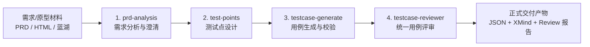

# TestSpec_SOP

TestSpec_SOP 是一套由 Agent 按技能说明执行的功能测试分析、设计、生成与评审交付流程。它将需求分析、测试点提炼、用例生成和用例评审分为四个核心阶段，评审阶段统一使用 `testcase-reviewer` 单一入口。

本 README 详细说明流程入口、交付产物、核心原则、评审门禁以及本地验证工具。技能文件与执行脚本中的具体规则约束优先。

---

## 流程概览



### 四个阶段职责分工

| 阶段 | 技能名称 | 核心目标 | 必需输入 | 主要产物 |
| --- | --- | --- | --- | --- |
| **Step 1** | [`prd-analysis`](skills/prd-analysis/SKILL.md) | 结构化拆解需求事实，整理边界、风险与未确认问题，建立规范需求源 | PRD 文本 / 蓝湖链接 / 交互 HTML / 用户故事 | `requirements.md`<br/>`requirements-analysis.md` |
| **Step 2** | [`test-points`](skills/test-points/SKILL.md) | 将需求提炼为精简测试点（“测什么”），运用 12 种设计方法标注优先级与 Oracle 范围 | `requirements-analysis.md` | `specs/testpoints.md` |
| **Step 3** | [`testcase-generate`](skills/testcase-generate/SKILL.md) | 展开完整集功能用例，执行命名与描述约束，输出规范 JSON 与 XMind | `specs/testpoints.md` | `artifacts/testcases.json`<br/>`artifacts/<名称>_cases.xmind` |
| **Step 4** | [`testcase-reviewer`](skills/testcase-reviewer/SKILL.md) | 同一轮执行通用评审与 SOP 14 项检查，复核发现并给出统一 Review Gate | `artifacts/testcases.json`<br/>`specs/testpoints.md` | `review-report.md` |

### 变更目录标准结构

TestSpec 在处理具体需求时统一在 `testspec/changes/<change-name>/` 下累积材料：

```text
testspec/changes/<change-name>/
├── requirements.md                 # 规范需求源（缺省时 proposal.md 作为回退）
├── requirements-analysis.md        # 需求分析报告
├── specs/
│   └── testpoints.md               # 结构化测试点
├── artifacts/
│   ├── testcases.json             # 统一完整用例集（schema_version: 2）
│   └── <name>_cases.xmind          # 完整用例集 XMind 8 格式脑图
└── review-report.md                # 统一评审报告（包含 Review Gate 结论）
```

---

## 阶段技能说明与调用规范

### Step 1: 需求分析与澄清 (`prd-analysis`)

- **定位**：流程第一步，负责需求事实挖掘与质量把关。
- **输入支持**：
  - PRD 文档、用户故事、需求片段；
  - 蓝湖 Axure 原型（使用直连脚本 `direct_extract_axure.py` 逐页读取文本与截图证据）；
  - 可交互本地 HTML 页面（按 `html-prd-input.md` 提取按钮清单 `BTN_ID`，逐项执行交互验证并记录可观察结果）。
- **核心约束**：严禁推测不存在的业务规则；发现歧义或口径矛盾时列入阻塞澄清项，不扫描底层生产代码。

### Step 2: 测试点设计 (`test-points`)

- **定位**：将需求分析提炼为精简验证清单（“测什么”，一句话一条），不做长步骤展开。
- **12 种测试设计方法**：在测试点中明确声明并落实：
  1. 等价类划分
  2. 边界值分析
  3. 判定表分析
  4. 业务流程分析
  5. 状态转换测试
  6. 错误推测法
  7. 正交实验设计
  8. 因果图分析
  9. 配对组合测试
  10. 基于属性的测试（Property-Based Testing）
  11. 变形测试（Metamorphic Testing）
  12. 语法规则分析（Grammar/Structure Testing）
- **范围约束**：严格限定于功能用例、有明确事件触发与统计口径的埋点（Tracking）、以及环境组合可判定的兼容性矩阵（Compatibility）。不设计独立 API、安全攻防与性能负载测试点。

### Step 3: 用例生成与格式输出 (`testcase-generate`)

- **定位**：根据测试点生成完整功能测试用例集，兼顾执行效率与机器可校验性。
- **用例固定八项业务字段**：
  1. `module`（模块）
  2. `submodule`（子模块）
  3. `test_name`（格式统一为 `{模块}_{功能点}_{场景}`，场景短句直白见名知意）
  4. `preconditions`（前置条件，仅保留角色、权限与必要初始状态）
  5. `test_data`（测试数据，保留精准数值、格式、单位与边界值）
  6. `steps`（按序号输出的动宾短句操作步骤）
  7. `expected_result`（具有明确业务 Oracle 的可观察预期结果）
  8. `priority`（优先级，仅允许 `p0`、`p1`、`p2`）
- **XMind 导出标准**：
  - 采用标准 XMind 8 格式（`generate_xmind.py`）；
  - 脑图层级：`模块 → 子模块 → 场景名称`（前置条件、测试数据、操作步骤为并列子节点，预期结果为操作步骤的子节点）；
  - 优先级 Marker 映射：`p0` 不打标记，`p1` 对应 `priority-1`，`p2` 对应 `priority-2`。
- **交付要求**：始终交付当前范围的**完整集**，不单独拆分交付冒烟子集；Excel 不属于默认产物或验收门禁。

### Step 4: 统一用例评审 (`testcase-reviewer`)

- **定位**：流程终点与交付质量门禁。原 `testcase-review` 模块已收敛为其内部子模块，`testcase-reviewer` 为唯一调用入口。
- **双轨统一执行（每次调用均执行）**：
  1. **通用评审（General Review）**：基于原始需求与完整测试稿，从覆盖度、意图一致性、边界充分性及可执行性进行评审，采用 `Critical / High / Medium / Low` 评级；支持传统用例、测试套件评分、设计辅导及 BDD 评审/改写。
  2. **SOP 14 项检查**：加载 `review-workflow.md`，执行输入健康检查与原有 14 维度检查（规则检查 R1-R6，启发式检查 H1-H8），严格核验四项描述门禁（前置条件、数据、步骤、预期）。
  3. **统一汇总与 Gate 判定**：逐项复核通用发现并映射到 SOP 维度（采纳/重复/不适用/待确认），计算 Review Gate。
- **弱输入与单体材料自适应**：
  - 缺少上游 `testcases.json` 或 `specs/testpoints.md`（如直接提供独立 XMind、Excel 或普通用例）时，仍照常执行通用评审并给出可判定的质量缺陷，SOP 状态标为“未完成”，Gate 记为“未计算”，严禁伪造通过结论。

---

## SOP 14 项评审维度与门禁规则

### 14 项检查维度索引

- **R1 覆盖度**：测试点到用例覆盖率 $\ge 95\%$（基于 `tp_refs` 精确计算）。
- **R2 命名契约**：三段式命名 `{模块}_{功能点}_{场景}`，场景短句清晰，无编号或套话替代。
- **R3 优先级分布**：冒烟用例全部为 `p0`；警惕 `p0 > 80%` 或 `p2 > 50%` 的分布失衡。
- **R4 字段完整性**：八项业务字段必须完整且非空。
- **R5 可执行性最小条件**：步骤包含明确动作动词，数据提供判定必需的值与边界，无模糊泛称。
- **R6 可追溯性**：所有用例必须包含有效 `tp_refs` 并映射至测试点。
- **H1 冗余检测**：识别步骤与预期完全镜像的重复用例（相同断言的仪式感用例评估合并）。
- **H2 预期结果质量**：排查“正常/成功/无异常”等弱断言，确保包含业务对象变化与判定依据。
- **H3 意图一致性**：三段式匹配（Action Match / Oracle Match / Scope Match），检查范围是否超纲。
- **H4 前置条件充分性**：检查是否区分已发布与草稿状态、权限隔离与环境配置。
- **H5 风险与边界覆盖**：检查核心业务规则、正向、负向、边界、异常、埋点等适用类型覆盖。
- **H6 可维护性建议**：识别四项描述中的套话冗余，给出可直接替换的精简写法。
- **H7 回归价值与仪式感用例**：通过反事实提问检查逻辑反转时能否变红，排除仅验证表面响应的仪式感用例。
- **H8 测试亮点识别**：沉淀具有代表性的优秀用例模式与设计标杆（仅正向反馈，不判失败）。

### 严格通过门禁（Review Gate Pass）

只有同时满足以下条件，用例交付才被判定为通过：
1. `s1_unresolved_count = 0` 且 `s1_issue_ids = []`（无任何未修复的 S1 阻断级缺陷）；
2. `description_unresolved_count = 0` 且 `description_issue_ids = []`（四项描述确认的问题全部修复闭环）；
3. 通用评审与 SOP 检查两部分均完整执行，两部分发现逐项处置完毕；
4. `review_gate.status = pass`。

---

## 本地工具与脚本命令示例

所有命令均从 SOP 根目录执行：

```bash
CHANGE_DIR="testspec/changes/your-change"
```

### 1. 结构化校验与导出 XMind

```bash
# 对完整 JSON 用例集与测试点执行完整契约校验
python3 -B skills/_testspec-shared/scripts/validate_testcases.py \
  --input "$CHANGE_DIR/artifacts/testcases.json" \
  --testpoints "$CHANGE_DIR/specs/testpoints.md" \
  --full

# 从 JSON 生成标准 XMind 8 脑图文件
python3 -B skills/testcase-generate/scripts/generate_xmind.py \
  --input "$CHANGE_DIR/artifacts/testcases.json" \
  --output "$CHANGE_DIR/artifacts/feature_cases.xmind" \
  --title "功能测试用例"
```

### 2. 检查跨阶段上下文链与版本传递

```bash
python3 -B skills/_testspec-shared/scripts/validate_context_chain.py \
  --change-dir "$CHANGE_DIR" \
  --through review
```

### 3. 生成独立 Reviewer 评测投影副本

```bash
REVIEW_RUN="run-$(date +%Y%m%d)"
python3 -B skills/testcase-reviewer/testcase-review/scripts/prepare_reviewer_input.py \
  --testcases "$CHANGE_DIR/artifacts/testcases.json" \
  --requirements "$CHANGE_DIR/requirements.md" \
  --output ".testspec-cache/reviewer/$REVIEW_RUN/input.json"
```

---

## 自动化测试与质量基线

截至 **2026-10-30**，全套技能与共享框架的确定性自动化回归测试结果为 **168/168 项全部通过**：

- `prd-analysis` 单元测试：**9 项通过**
- `testcase-generate` 单元测试：**47 项通过**
- `_testspec-shared` 工具与契约测试：**96 项通过**
- `testcase-reviewer` 集成与门禁测试：**16 项通过**
- 技能结构契约校验 (`validate_skill_contracts.py`)：**PASS**
- 合成评测规范校验 (`validate_evals.py`)：**PASS**
- Reviewer 技能库规范校验 (`validate_skill_repo.py`)：**PASS**

### 复跑全套验证套件命令

```bash
# 1. 运行四组单元测试
python3 -B -m unittest discover -s skills/prd-analysis/tests -p 'test_*.py'
python3 -B -m unittest discover -s skills/testcase-generate/tests -p 'test_*.py'
python3 -B -m unittest discover -s skills/_testspec-shared/tests -p 'test_*.py'
python3 -B -m unittest discover -s skills/testcase-reviewer/testcase-review/tests -p 'test_*.py'

# 2. 运行技能契约、Eval与仓库结构检查
python3 -B skills/_testspec-shared/scripts/validate_skill_contracts.py
python3 -B skills/_testspec-shared/scripts/validate_evals.py
python3 -B skills/testcase-reviewer/scripts/validate_skill_repo.py skills/testcase-reviewer
```

---

## 仓库目录导航

```text
TestSpec_SOP/
├── AGENTS.md                          # 代理行为准则与底线约束
├── README.md                          # 本说明文档
└── skills/
    ├── prd-analysis/                  # Step 1: 需求结构化分析技能
    │   ├── SKILL.md
    │   ├── references/               # 模式定义、HTML输入适配、蓝湖直连等
    │   ├── scripts/                  # direct_extract_axure.py
    │   └── tests/
    ├── test-points/                   # Step 2: 测试点设计技能
    │   ├── SKILL.md
    │   ├── references/               # 12种测试设计方法、规则与模板
    │   └── evals/
    ├── testcase-generate/             # Step 3: 用例生成与脑图导出技能
    │   ├── SKILL.md
    │   ├── references/               # 用例粒度、设计规则、字段示例等
    │   ├── scripts/                  # generate_xmind.py, export_md_to_xmind.py
    │   └── tests/
    ├── testcase-reviewer/             # Step 4: 统一用例评审入口技能 (v2.0)
    │   ├── SKILL.md                  # 唯一主入口（通用评审 + SOP 14 项检查）
    │   ├── LICENSE
    │   ├── references/               # 通用用例与BDD评审规则
    │   ├── testcase-review/          # SOP 14项检查内部执行模块
    │   │   ├── review-workflow.md
    │   │   ├── references/           # review-dimensions.md, independent-reviewer.md
    │   │   ├── scripts/              # prepare_reviewer_input.py
    │   │   └── tests/
    │   └── scripts/                  # validate_skill_repo.py
    └── _testspec-shared/              # 跨技能共享资产与基础设施
        ├── templates/                 # 统一评审/需求分析/BDD报告模板
        ├── references/               # output-contracts.md, naming-contract.md等
        ├── scripts/                  # validate_testcases.py, validate_context_chain.py等
        └── tests/
```

### 关键规范速查索引

- [TestSpec 统一输出契约](skills/_testspec-shared/references/output-contracts.md)
- [统一命名契约与规则](skills/_testspec-shared/references/naming-contract.md)
- [统一评审协同与处置机制](skills/testcase-reviewer/testcase-review/references/independent-reviewer.md)
- [14 维度评审细则](skills/testcase-reviewer/testcase-review/references/review-dimensions.md)
- [12 种测试设计方法详解](skills/test-points/references/test-design-methods.md)
- [用例四项描述设计准则](skills/testcase-generate/references/case-design-rules.md)
